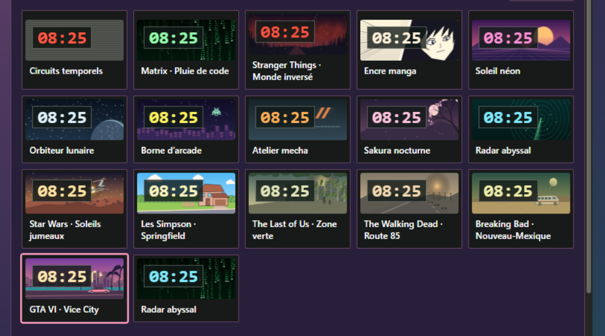
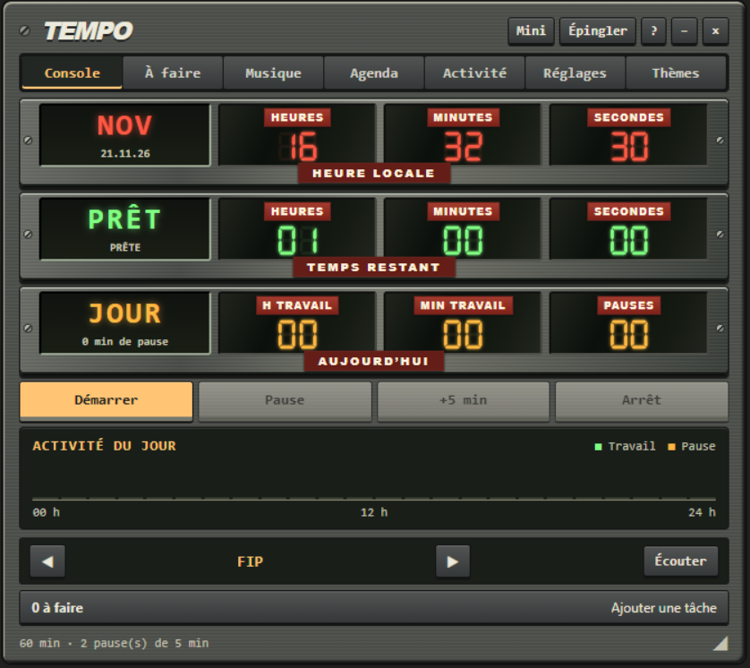

# Tempo

Une console de bureau pour organiser ses séances de travail, prendre des pauses et suivre son activité.

Créée par **Adeline Courtois**, graphiste freelance à Lille, spécialisée en logos minimalistes et identités visuelles pour les SaaS B2B.

[Site et portfolio](https://adelinecourtois.fr/) · [LinkedIn](https://fr.linkedin.com/in/adelinecourtois) · contact@adelinecourtois.fr

## Installer

Télécharge [Tempo pour Windows 64 bits](release/Tempo-Windows.zip), extrais le ZIP et lance **Installer Tempo.msi**. Un raccourci Tempo apparaît sur ton bureau.

Le dossier contient aussi **Désinstaller Tempo.exe** et le guide utilisateur. L’application nécessite Microsoft Edge WebView2 Runtime.

## Fonctionnalités

- **Minuteur de travail et pauses programmées.** Choisis la durée de ta séance, le nombre de pauses et leur durée. Tempo affiche le temps restant et peut jouer une sonnerie au moment de s’arrêter ou de reprendre. C’est utile pour rester concentré sans oublier de souffler.
- **Suivi de l’activité.** Le tableau de bord comptabilise le temps travaillé, les pauses et leur durée. Un graphique permet de relire la journée, puis de consulter les tendances de la semaine et du mois sans tenir un relevé à la main.
- **Liste de tâches avec rappels.** Ajoute ce que tu dois faire aujourd’hui et associe une heure aux tâches importantes. Tempo te rappelle une réunion, un appel ou une échéance pendant que tu travailles.
- **Agenda iCalendar.** Ajoute un calendrier compatible iCalendar pour retrouver tes rendez-vous dans l’application et recevoir un rappel lorsqu’un événement approche.
- **Radio et musique.** Choisis un flux radio ou colle un lien YouTube dans l’onglet Musique. Le lecteur reste intégré à Tempo afin de garder ton environnement de travail au même endroit.
- **Fenêtre adaptée au bureau.** Redimensionne Tempo, épingle la fenêtre au-dessus des autres applications ou passe en mode Mini pour ne garder que l’essentiel dans un coin de l’écran.
- **Thèmes graphiques.** Change entièrement l’ambiance de la console avec les univers inclus. Les thèmes exportés au format `.tempo-theme` peuvent être conservés, partagés et importés plus tard.

## Pourquoi utiliser Tempo ?

Tempo regroupe dans une seule petite application le minuteur, les pauses, les tâches, les rendez-vous et la musique. Tu gardes une vue claire sur ta journée sans multiplier les onglets pendant une session de travail.

L’application fonctionne directement sur Windows, sans compte à créer. Tes réglages, tes tâches et ton historique restent enregistrés localement sur ton ordinateur. Tu peux donc t’en servir comme compagnon de bureau quotidien, puis le réduire dès que tu as seulement besoin de voir l’heure ou le temps restant.

Les réglages et l’historique sont enregistrés dans %LOCALAPPDATA%\TempoRadio. Les rappels fonctionnent lorsque Tempo reste ouvert. Les radios, YouTube et les calendriers distants utilisent Internet.

## Exemples de thèmes

Tempo contient plusieurs univers graphiques qui modifient les couleurs, les décors et la disposition de la console. Voici quelques exemples inclus dans cette version.

| Circuits temporels | Monde inversé |
| --- | --- |
|  |  |

| Nouveau-Mexique | Vice City |
| --- | --- |
|  |  |

Ces thèmes sont des exemples. D’autres thèmes seront proposés prochainement au téléchargement et pourront être importés directement dans Tempo au format `.tempo-theme`.

## Compiler

Sur Windows 64 bits, avec PowerShell 5.1 ou ultérieur et .NET Framework 4.8, lance à la racine du projet

    powershell -NoProfile -ExecutionPolicy Bypass -File .\scripts\build.ps1

Le script restaure les versions figées de NAudio, WebView2 et WiX, contrôle les archives par SHA-256, puis construit l’application, le MSI et le désinstalleur. La distribution apparaît dans dist/Tempo-Windows.zip.

Pour une nouvelle version, augmente Product/@Version dans installer/Tempo.wxs. Conserve UpgradeCode pour permettre les mises à niveau.

## Organisation du projet

- src/ — application Windows et désinstalleur.
- ui/ — interface locale et décors.
- assets/ — icône.
- scripts/ — restauration et compilation.
- installer/ — définition du MSI.
- themes/ — exemple de thème importable.
- vendor/ et licenses/ — composant JavaScript intégré et notices.
- docs/ — guide utilisateur.
- release/ — archive utilisateur prête à télécharger.

## Créer un thème

Dans Thèmes, sélectionne un univers, ajuste ses couleurs et ajoute éventuellement une illustration. Exporte le thème actif au format .tempo-theme. Ce fichier peut être importé par un autre utilisateur. Un exemple est fourni dans themes/.

## Utilisation

Tempo est une ressource gratuite. Sa revente, seule ou dans un lot, un abonnement ou une offre payante, nécessite l’accord écrit d’Adeline Courtois. Consulte [les conditions](LICENSE.txt) et [les notices des composants tiers](THIRD-PARTY-NOTICES.md).

Les noms et univers évoqués appartiennent à leurs titulaires respectifs. Tempo est une création indépendante.

