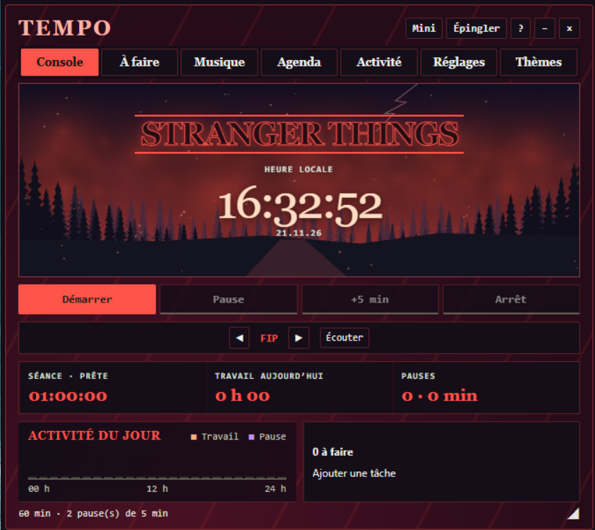
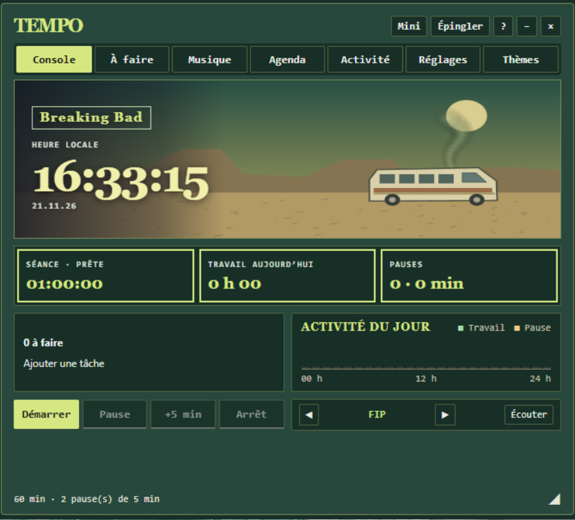
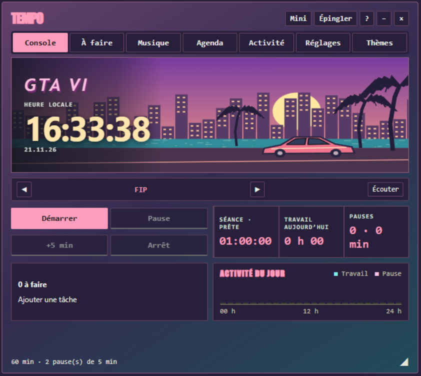

# Tempo

Une console de bureau pour organiser ses séances de travail, prendre des pauses et suivre son activité.

Créée par **Adeline Courtois**, graphiste freelance à Lille, spécialisée en logos minimalistes et identités visuelles pour les SaaS B2B.

[Site et portfolio](https://adelinecourtois.fr/) · [LinkedIn](https://fr.linkedin.com/in/adelinecourtois) · contact@adelinecourtois.fr

## Installer

Télécharge [Tempo pour Windows 64 bits](release/Tempo-Windows.zip), extrais le ZIP et lance **Installer Tempo.msi**. Un raccourci Tempo apparaît sur ton bureau.

Le dossier contient aussi **Désinstaller Tempo.exe** et le guide utilisateur. L’application nécessite Microsoft Edge WebView2 Runtime.

## Fonctionnalités

- Séances à rebours, pauses programmées et sonneries.
- Liste de tâches avec rappels horaires et agenda iCalendar.
- Historique quotidien, hebdomadaire et mensuel.
- Radio et lecteur YouTube dans l’onglet Musique.
- Mode Mini, fenêtre redimensionnable et épinglée.
- Univers graphiques et thèmes personnalisés importables.

Les réglages et l’historique sont enregistrés dans %LOCALAPPDATA%\TempoRadio. Les rappels fonctionnent lorsque Tempo reste ouvert. Les radios, YouTube et les calendriers distants utilisent Internet.

## Exemples de thèmes

Tempo contient plusieurs univers graphiques qui modifient les couleurs, les décors et la disposition de la console. Voici quelques exemples inclus dans cette version.

| Circuits temporels | Monde inversé |
| --- | --- |
|  |  |

| Nouveau-Mexique | Vice City |
| --- | --- |
|  |  |

Ces thèmes sont des exemples. D’autres thèmes seront proposés prochainement au téléchargement et pourront être importés directement dans Tempo au format `.tempo-theme`.

## Compiler

Sur Windows 64 bits, avec PowerShell 5.1 ou ultérieur et .NET Framework 4.8, lance à la racine du projet

    powershell -NoProfile -ExecutionPolicy Bypass -File .\scripts\build.ps1

Le script restaure les versions figées de NAudio, WebView2 et WiX, contrôle les archives par SHA-256, puis construit l’application, le MSI et le désinstalleur. La distribution apparaît dans dist/Tempo-Windows.zip.

Pour une nouvelle version, augmente Product/@Version dans installer/Tempo.wxs. Conserve UpgradeCode pour permettre les mises à niveau.

## Organisation du projet

- src/ — application Windows et désinstalleur.
- ui/ — interface locale et décors.
- assets/ — icône.
- scripts/ — restauration et compilation.
- installer/ — définition du MSI.
- themes/ — exemple de thème importable.
- vendor/ et licenses/ — composant JavaScript intégré et notices.
- docs/ — guide utilisateur.
- release/ — archive utilisateur prête à télécharger.

## Créer un thème

Dans Thèmes, sélectionne un univers, ajuste ses couleurs et ajoute éventuellement une illustration. Exporte le thème actif au format .tempo-theme. Ce fichier peut être importé par un autre utilisateur. Un exemple est fourni dans themes/.

## Utilisation

Tempo est une ressource gratuite. Sa revente, seule ou dans un lot, un abonnement ou une offre payante, nécessite l’accord écrit d’Adeline Courtois. Consulte [les conditions](LICENSE.txt) et [les notices des composants tiers](THIRD-PARTY-NOTICES.md).

Les noms et univers évoqués appartiennent à leurs titulaires respectifs. Tempo est une création indépendante.
